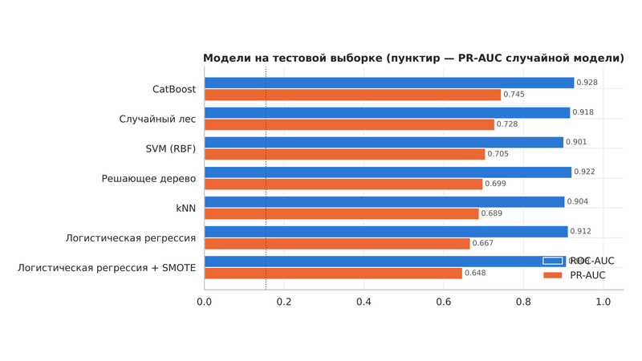
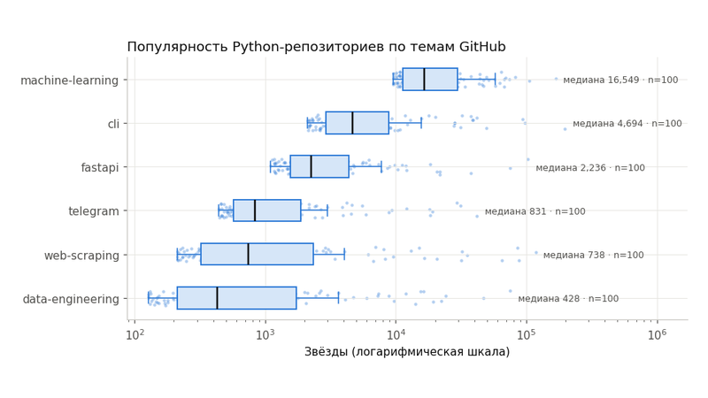
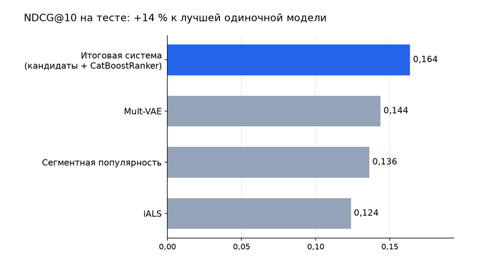
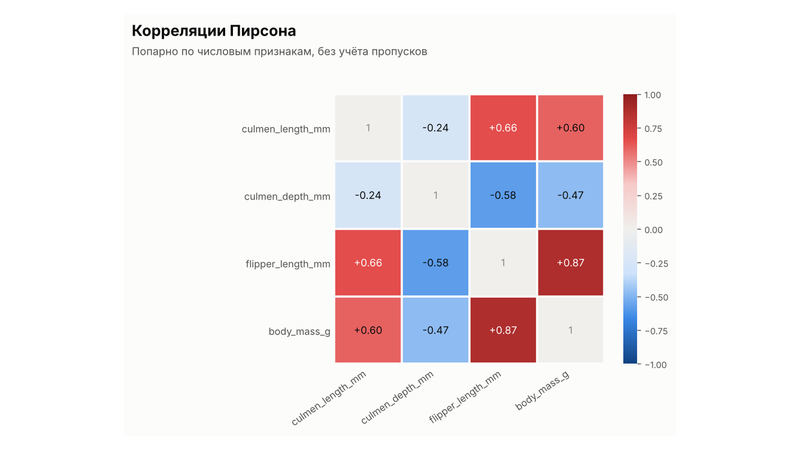
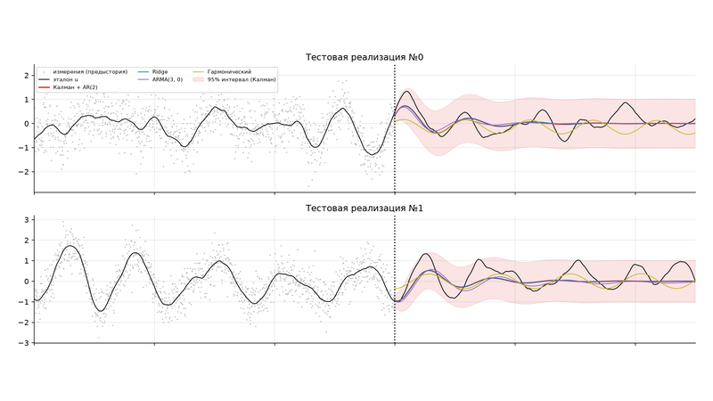
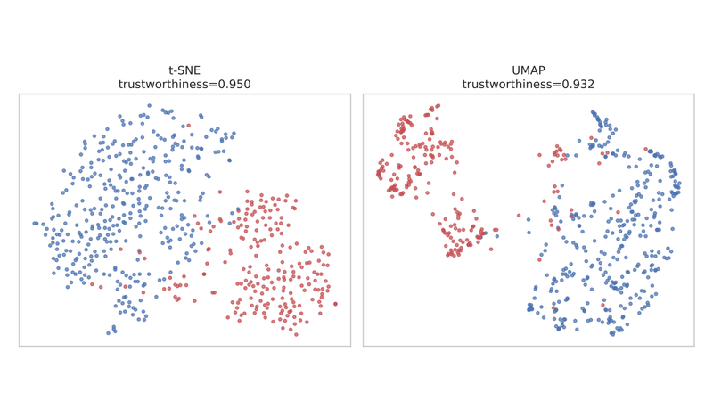
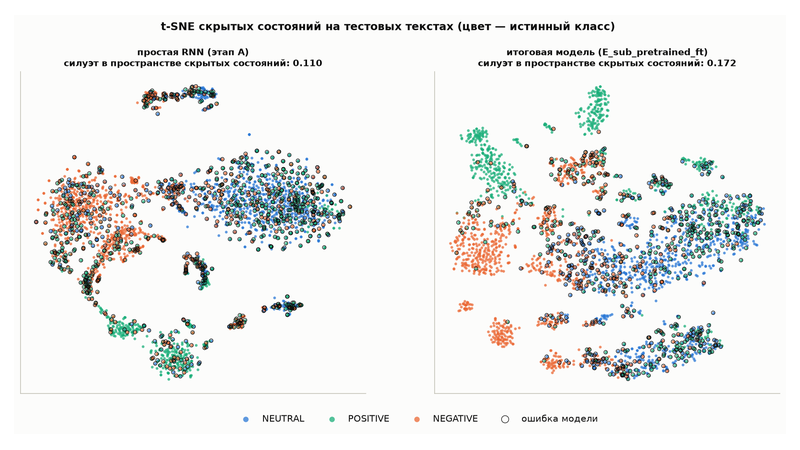

  

  
  
  

## 👋 About Me

* Data analyst focused on BI: SQL, Power BI, Excel / Power Query, 1C, Python
* Master's student in Applied Mathematics and Informatics at Perm State University
* Looking for a full-time remote BI Analyst position

---

## 🎓 Education

* **Master's degree (in progress)**, Perm State University *(2025 — present)*
  * Field of study: *Applied Mathematics and Informatics*
* **Bachelor's degree**, Perm State University & Moscow Institute of Physics and Technology (MIPT) *(2021 — 2025)*
  * Fields of study: *Applied Mathematics and Informatics; Artificial Intelligence and Big Data*

---

## 🛠 Tech Stack

### BI & Analytics

  
  
  
  
  

### Programming & Data

  
  
  
  
  
  

### Machine Learning

  
  
  
  

### Databases & Data Engineering

  
  
  
  
  
  
  
  

---

## 📊 Projects

<table>
  <tr>
    <td width="50%" valign="top">
      
       <b><a href="https://github.com/Meta1rus/eda-classification">Purchase prediction for online store sessions</a></b>
       EDA → 7 models → SHAP → dashboard in Docker
       CatBoost: <b>ROC-AUC 0.929</b> on the test set
    </td>
    <td width="50%" valign="top">
      
       <b><a href="https://github.com/Meta1rus/web-data-extraction">Web data collection and an n8n pipeline</a></b>
       REST API, Scrapy, Playwright, data quality checks, orchestration
       Data on <b>592 repositories</b> with zero rejected records
    </td>
  </tr>
  <tr>
    <td width="50%" valign="top">
      
       <b><a href="https://github.com/Meta1rus/recommender-systems">Two-stage recommender system</a></b>
       iALS and Mult-VAE candidates + CatBoostRanker on KION data
       NDCG@10 <b>14% higher</b> than the best single model
    </td>
    <td width="50%" valign="top">
      
       <b><a href="https://github.com/Meta1rus/python-data-analysis">Telegram bot for exploratory analysis of CSV files</a></b>
       Summary, charts and an Excel report for an uploaded table
       Covered by <b>26 offline tests</b>
    </td>
  </tr>
  <tr>
    <td width="50%" valign="top">
      
       <b><a href="https://github.com/Meta1rus/time-series-regression">Kalman filter signal forecasting and 16 time series labs</a></b>
       AR(2), SARIMA, Prophet, DTW, ROCKET, echo state networks
       Useful forecast horizon <b>7 s vs 1.2 s</b> for the naive forecast
    </td>
    <td width="50%" valign="top">
      
       <b><a href="https://github.com/Meta1rus/clustering-dimensionality-reduction">Unsupervised clustering: 24 pipelines</a></b>
       UMAP, t-SNE, PCA, Isomap, stability analysis
       <b>94%</b> agreement between clusters and diagnosis
    </td>
  </tr>
  <tr>
    <td width="50%" valign="top">
      
       <b><a href="https://github.com/Meta1rus/neural-networks">Russian sentiment analysis and 10 PyTorch practices</a></b>
       BiLSTM + rubert-tiny2, CNN, transfer learning, VAE, transformers
       <b>macro-F1 0.751</b> on the test set
    </td>
    <td width="50%" valign="middle" align="center">
      <a href="https://github.com/Meta1rus?tab=repositories"><b>All repositories →</b></a>
       every README states the result; data is downloaded by scripts; project READMEs are in Russian
    </td>
  </tr>
</table>
